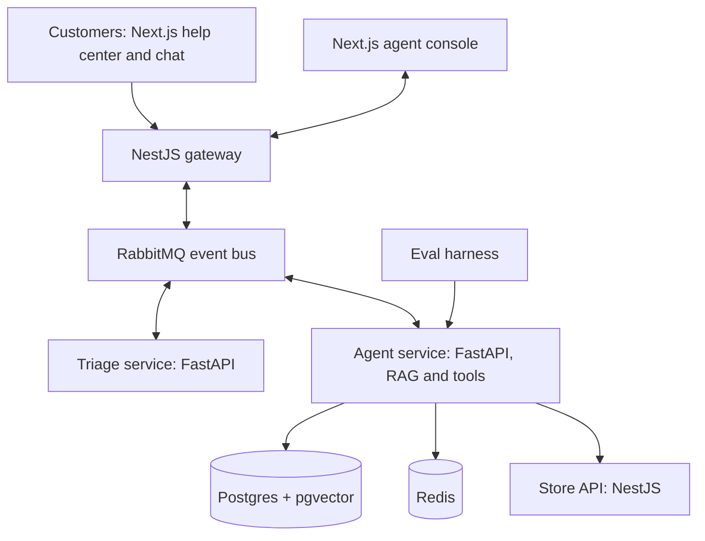

# Qioskoh Support Agent

An AI customer support agent for Qioskoh, a fictional online store that runs its own delivery riders. It triages tickets, answers from the store's policies and order data, drafts replies, and hands risky actions like refunds to a human for approval.

> Qioskoh is a fictional company. All customers, orders and tickets in this repo are synthetic.

## Why this project

I am a senior fullstack engineer moving into AI engineering. Instead of building many small demos, I am building one production-style system over 14 weeks, in public, adding one capability each week and measuring it.

Every result in this README is measured on a stated dataset. Results that did not work are reported too.

## Architecture

## Stack

| Layer          | Tools                                      |
| -------------- | ------------------------------------------ |
| Frontend       | Next.js, React                             |
| Backend        | NestJS, TypeScript                         |
| AI services    | Python, FastAPI, Claude API                |
| Data           | Postgres with pgvector, Redis              |
| Messaging      | RabbitMQ                                   |
| Infrastructure | Docker, Kubernetes, Helm, Terraform on GCP |
| Quality        | Evals in CI, OpenTelemetry tracing         |

## Roadmap

- [ ] Week 1 · Foundations: services, Docker Compose, ticket intake
- [ ] Week 2 · Events across NestJS and Python with RabbitMQ
- [ ] Week 3 · Policy knowledge base and retrieval evals
- [ ] Week 4 · Triage classifier with labelled evals
- [ ] Week 5 · Caching, rate limits and model routing
- [ ] Week 6 · Agent with tools and a chat widget
- [ ] Week 7 · Human approval, escalation and reflection
- [ ] Week 8 · Prompt injection defences and failure handling
- [ ] Week 9 · Agent console
- [ ] Week 10 · Tracing and cost per ticket
- [ ] Week 11 · Kubernetes and autoscaling on queue depth
- [ ] Week 12 · Terraform on GCP
- [ ] Week 13 · CI with eval gates
- [ ] Week 14 · MCP server and case study

## Results

No results yet. This table fills in as each week ships.

| Week | What was measured | Dataset | Result |
| ---- | ----------------- | ------- | ------ |

## Running locally

Setup instructions arrive with Week 1.

## Data

Seed tickets come from the [Bitext customer support dataset](https://huggingface.co/datasets/bitext/Bitext-customer-support-llm-chatbot-training-dataset), licensed under CDLA-Sharing 1.0. All store data is generated.

## License

MIT
